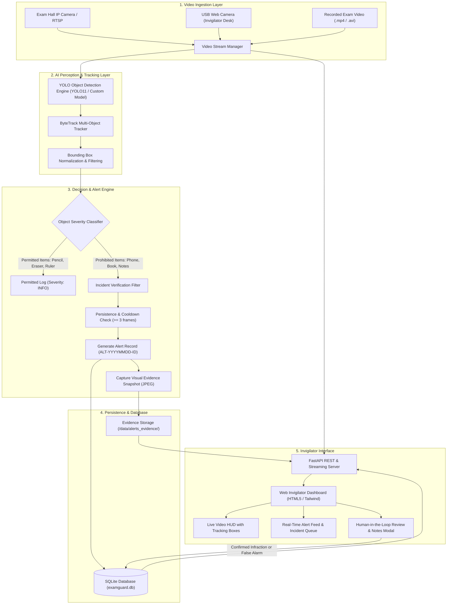
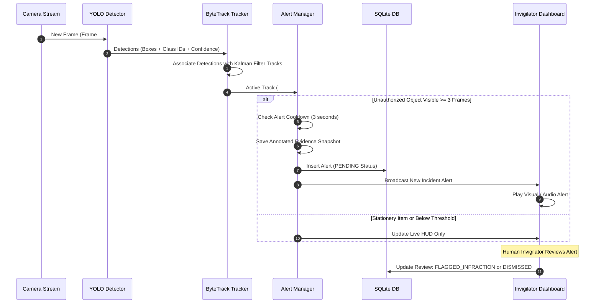

# ExamGuard: System Architecture & Workflow

ExamGuard is designed as an AI-assisted monitoring system that enhances examination hall integrity by detecting prohibited objects and assisting human invigilators.

---

## 1. High-Level System Architecture

---

## 2. Multi-Object Tracking Pipeline (ByteTrack)

---

## 3. Human-in-the-Loop Review Philosophy

A core tenet of ExamGuard is that **AI never accuses a student directly**:
* AI is purely an anomaly detection sensor.
* Detections create an **incident alert** with a time-stamped evidence frame.
* The human invigilator inspects the evidence, physically verifies the desk, and records their decision and remarks in the audit log.

